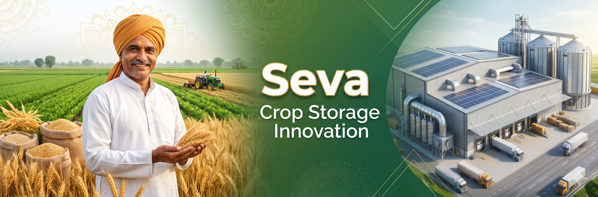

### Research-Driven Technology for Better Crop Storage Accessibility and Management

**Seva Innovation Challenge | Agriculture & Farming Domain**
## Project Preview


---

## 🌱 About the Project

Seva is a research-driven innovation project focused on identifying and addressing existing gaps in crop storage accessibility and management for Indian farmers.

Despite the availability of government warehouses, cold storage facilities, private storage providers and digital platforms, farmers may still encounter challenges related to storage accessibility, cost transparency, real-time availability and crop condition monitoring.

Our goal is not to develop another conventional cold storage booking platform. Instead, we aim to understand existing solutions, identify their limitations and develop a practical technology-based solution that addresses a genuine, underserved problem.

## 🎯 Problem Statement

Farmers often face difficulties in finding suitable and affordable storage facilities for their harvested crops.

Potential challenges include:

- Limited storage accessibility for small-scale farmers.
- Uncertainty regarding actual vacant storage capacity.
- Lack of transparent and comparable storage charges.
- Difficulties in monitoring stored crop conditions.
- Limited access to crop-specific storage information.
- Delayed alerts during power failures or abnormal storage conditions.
- Challenges in maintaining individual digital storage records.

**Our central question:**

How can technology help Indian farmers overcome the remaining gaps in existing crop storage management and accessibility systems?

## 💡 Our Innovation Approach

We follow a gap-based innovation methodology.

1. **Problem Identification:** Understand the real-world challenges faced by farmers.
2. **Existing Solution Research:** Study government initiatives, digital platforms and private storage systems.
3. **Gap Analysis:** Identify limitations and underserved areas in existing solutions.
4. **Ground-Level Validation:** Collect feedback from farmers and storage operators.
5. **Innovation Selection:** Select a genuine, evidence-supported problem.
6. **Technology Development:** Build a practical solution using appropriate technologies.
7. **Testing & Evaluation:** Evaluate the solution against real-world requirements.

## 🔍 Potential Research Areas

| Research Area          | What We Want to Investigate                    |
| ---------------------- | ---------------------------------------------- |
| Storage Accessibility  | Difficulties faced by small farmers            |
| Real-Time Availability | Accuracy of displayed vacant capacity          |
| Cost Transparency      | Clarity of storage charges                     |
| Crop Monitoring        | Access to stored crop condition information    |
| Crop-Specific Guidance | Availability of suitable storage information   |
| Power Failure Alerts   | Timeliness of abnormal-condition notifications |
| Digital Records        | Individual storage record management           |

*These are preliminary research areas, not yet confirmed gaps.*

## 🏛️ Existing Solutions Under Study

We intend to investigate the following:

- **NCCD:** National Centre for Cold-chain Development.
- **NHB:** National Horticulture Board.
- **WDRA:** Warehousing Development and Regulatory Authority.
- **Private Storage Systems:** Existing private cold storage and warehouse management solutions.

Our research will examine their features, accessibility, limitations and opportunities for improvement.

## 🛠️ Proposed Technology Stack

The final technology selection will depend on the verified problem.

| Technology | Purpose                                    |
| ---------- | ------------------------------------------ |
| HTML5      | Webpage structure                          |
| CSS3       | User interface and styling                 |
| JavaScript | Frontend interactions                      |
| Python     | Backend programming                        |
| Django     | Web application framework                  |
| Database   | Storage and management of application data |

Additional technologies such as APIs, IoT or AI/ML will be considered only if they are genuinely required by the selected solution.

## 👥 Team Members

**Team Name:** Seva Innovation Team
**Team Size:** 5 Members

| Member   | Responsibility                        |
| -------- | ------------------------------------- |
| Naim Molla | Frontend Developer |
| Gaurav Kumar | Backend Developer |
| Tanmoy Sarkar | AI/ML Developer |
| Sanjeev Singh | Database + Testing + Integration |

## 📂 Project Structure

```text
seva-crop-storage-innovation/
│
├── 01_Project_Overview/
├── 02_Existing_Solutions_Research/
├── 03_Gap_Identification/
├── 04_Farmer_Survey/
├── 05_Storage_Operator_Research/
├── 06_Solution_Design/
├── 07_UI_UX_Design/
├── 08_Development/
├── 09_Testing_and_Documentation/
├── 10_Hackathon_Submission/
│
├── README.md
├── CONTRIBUTING.md
├── LICENSE
└── .gitignore
```

## 🚧 Current Project Status

**Phase 1 – Research & Problem Validation**

- [ ] Repository setup
- [ ] Research existing government platforms
- [ ] Research private storage solutions
- [ ] Identify potential limitations
- [ ] Prepare farmer survey questionnaire
- [ ] Collect farmer feedback
- [ ] Interview storage operators
- [ ] Validate actual problem gaps
- [ ] Finalise the innovation concept
- [ ] Develop the working prototype

## 🌍 Expected Impact

Our vision is to develop a practical technological solution that can:

- Improve farmers' access to relevant storage information.
- Reduce avoidable post-harvest losses.
- Improve transparency in storage-related services.
- Support better crop storage management.
- Address the needs of small and marginal farmers.

These are intended outcomes and will be evaluated during development and testing.

## 🤝 Contribution

We welcome collaboration, suggestions and constructive feedback.

For team contributions:

1. Discuss the assigned task through GitHub Issues.
2. Create a separate branch for your work.
3. Commit changes with meaningful messages.
4. Submit a Pull Request for review.
5. Merge approved contributions into the main branch.

## 📌 Project Philosophy

> "Don't repeat an existing solution. Find what is missing in the existing solution and innovate to fill that gap."

Our mission is to identify real problems, validate them through research and build technology that creates meaningful social impact.

---

**Developed for Seva Innovation Challenge**
**Domain: Agriculture & Farming**
**Project: Crop Storage Management and Accessibility**
